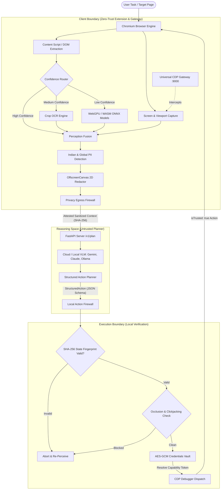

# NEXUS — Zero-Trust On-Device Visual Perception & Privacy Gateway for Autonomous Browser Agents

[](https://sih.gov.in)
[](https://www.isro.gov.in)
[]()
[]()
[]()
[]()
[]()

> **Smart India Hackathon (SIH) 2026 — PS 26171**  
> **Title:** *On-device Visual Perception for Light-weight Browser Agents*  
> **Organization:** Indian Space Research Organisation (ISRO), Department of Space, Government of India  
> **Theme:** Smart Automation (Software)

---

## 📌 Executive Overview

Modern autonomous AI web agents (e.g., Browser-Use, WebVoyager, Agent-S, Operator) interact with web applications by capturing full screenshots, streaming accessibility trees, and sending raw DOM structures to remote cloud Vision-Language Models (VLMs). 

In high-security, sovereign, and defense-critical environments—such as the **Indian Space Research Organisation (ISRO)**—this standard paradigm poses unacceptable risks:
- **Catastrophic Data Leakage:** Classified geospatial vector layers from **ISRO Bhuvan**, real-time oceanographic and meteorological telemetry from **MOSDAC**, ground station parameters, employee Aadhaar/PAN identities, and authentication secrets are transmitted directly to external cloud model providers.
- **Client Resource Exhaustion:** Running multi-billion-parameter local VLMs on commodity client endpoints results in severe GPU starvation, Out-Of-Memory (OOM) crashes, thermal throttling, and unacceptable latency.

**NEXUS** resolves this **High-Assurance Edge Trilemma** by implementing an asymmetric **Zero-Trust Edge-Cloud Architecture**:

```
                       THE HIGH-ASSURANCE EDGE TRILEMMA
                                     
                           [Pure Cloud VLM Agent]
                                   /    \
                 Data Exfiltration/      \ High Network Latency
                     Risk (ISRO) /        \ & Privacy Violations
                                /          \
      [NEXUS: Zero-Trust Edge] ────────────── [Pure Local VLM Agent]
        Lightweight WebGPU/WASM                 Resource Exhaustion
         Perception & Redaction                   (Client OOM / Lag)
```

NEXUS performs lightweight, deterministic visual perception and privacy sanitization **entirely on-device** inside the user's browser, enforces mathematical PII validation (including Indian national IDs), strips sensitive secrets, injects an un-bypassable **CDP Observation Gateway**, and transmits only **cryptographically attested, anonymized structured context** to remote reasoning engines. 

Proposed server actions are subjected to a **Local Action Firewall** on the client, verifying state freshness, origin boundaries, and element visibility before hardware-level execution.

---

## 🎯 Key Architectural Pillars

```text
DOM/ARIA First
   ↓
Confidence-Driven Selective Perception (DOM → OCR → WebGPU ONNX)
   ↓
Visual Grounding & Perception Fusion
   ↓
Local PII / Secret Detection (Aadhaar Verhoeff, PAN, Cards, Faces)
   ↓
Dual-Layer Redaction (DOM Occlusion + CDP Gateway Proxy)
   ↓
Minimum Necessary Disclosure Policy
   ↓
Cryptographic Egress Attestation (SHA-256 Digest)
   ↓
Server VLM Reasoning (FastAPI / Anthropic / Gemini / OpenAI / Ollama)
   ↓
Local Action Firewall (State Fingerprint, Clickjacking Defense, Origin Checks)
   ↓
Capability-Based Secret Injection (AES-GCM Web Crypto)
   ↓
Hardware-Level Action Execution (CDP isTrusted Events)
```

### 1. DOM/ARIA-First Confidence Router
Instead of capturing heavy screenshots for every minor DOM step, NEXUS implements an intelligent confidence router:
- **HIGH Confidence:** Standard semantic HTML elements and ARIA trees are parsed in sub-millisecond time directly via DOM APIs.
- **MEDIUM Confidence:** Visual text, cropped canvas labels, and badges trigger targeted, crop-based local OCR.
- **LOW Confidence:** Complex spatial renderings (e.g., ISRO Bhuvan geospatial maps, WebGL visualizations, opaque canvas elements) invoke local neural models.

### 2. On-Device Vision Engine (WebGPU / WASM / ONNX)
- Runs lightweight, quantized neural networks directly within an **Offscreen Document** using **ONNX Runtime Web**.
- Hardware acceleration priority: **WebGPU → WebGL → WASM**.
- Embedded **YuNet** face detection model (~1 MB) detects biometric faces and profile images in real time without sending pixels off-device.

### 3. Comprehensive Indian & Global PII Validation Engine
NEXUS incorporates a dedicated detection and verification suite specifically calibrated for Indian statutory compliance:
- **Aadhaar Number:** 12-digit identification validated using the **Verhoeff Dihedral Group $D_5$ Checksum Algorithm**, completely eliminating false-positive number matching.
- **PAN (Permanent Account Number):** Strict alphanumeric pattern matching (`[A-Z]{5}[0-9]{4}[A-Z]{1}`) with 4th-character entity categorization.
- **Voter ID (EPIC):** Standard Election Commission 3-letter alphanumeric series.
- **Indian Driving Licence & Passport:** Ministry of Road Transport & Highways and Indian Passport standards.
- **Financial Data:** Bank Account Numbers, 11-character Indian Financial System Codes (IFSC), UPI Virtual Payment Addresses (VPAs), and Credit/Debit Cards validated via the **Luhn Algorithm**.
- **Contact & Personal:** Indian mobile series (`+91` 10-digit mobile numbers starting with 6–9), email addresses, physical addresses, full person names, and dates of birth.

### 4. DPDP Act 2023 Compliance & Section 3(c) Smart Exemption
NEXUS is engineered in full alignment with India's **Digital Personal Data Protection (DPDP) Act 2023**:
- Mandatory anonymization of biometric personal identifiers.
- **Section 3(c) Exemption Engine:** Under Section 3(c), personal data made publicly available by the individual is exempt from standard processing restrictions. NEXUS automatically detects public video streaming domains (`youtube.com`, `vimeo.com`, `twitch.tv`, `netflix.com`, etc.) and prevents destructive blacking out of video frames and thumbnails (`[REDACTED: MEDIA]`), allowing autonomous agents to analyze video search results while preserving privacy everywhere else.

### 5. Dual-Layer Anti-Bypass Redaction
Traditional extension-only redaction modifies in-memory copies of screenshots, allowing external CDP agents (like BrowserOS or Playwright) to bypass privacy by querying `Page.captureScreenshot` directly from Chromium's compositor. NEXUS deploys a two-tier defense:
1. **Render-Time DOM Occlusion:** Injects top-layer DOM elements (`position: fixed`, `z-index: 2147483647`, full black `#000000` with labels like `[REDACTED: AADHAAR]`) directly into the page's render tree so the browser compositor itself bakes the redaction into every native screen grab.
2. **Universal CDP Observation Gateway (`ps-cdp-gateway.ts`):** A high-performance WebSocket proxy placed between external agents (port `9000` or `9005`) and the Chromium remote debugging port (`9001`). The gateway intercepts `Page.captureScreenshot`, `Page.startScreencast`, and Accessibility snapshots, replaces unredacted frames with attested sanitized bitmaps, and enforces single-tab read-only scoping (e.g. for Google Meet sessions).

### 6. Local Encrypted Credentials Vault (Zero-Knowledge LLM)
- Eliminates plaintext password and API key exposure to LLMs.
- Master keys are generated on-the-fly and stored in volatile session memory (`chrome.storage.session`).
- Vault entries are encrypted with **256-bit AES-GCM** in IndexedDB.
- The remote planner receives only opaque capability handles (e.g., `ref: cap_pwd_github`).
- During action execution, the extension resolves the handle locally, verifies `allowed_origins`, and injects the credential using `Input.dispatchKeyEvent` via Chrome Debugger. Plaintext secrets never enter LLM prompts.

### 7. Zero-Trust Local Action Firewall
Every action command emitted by the remote server is treated as hostile until proven safe:
- **State Fingerprinting:** Computes a SHA-256 hash of the rendered DOM. If layout drift, popups, or navigation occurred between perception and execution, the action is rejected to prevent race conditions.
- **Clickjacking Defense:** Conducts `document.elementFromPoint()` raycasting to verify the target element is neither occluded, zero-opacity, nor out of the viewport.
- **Origin & Frame Binding:** Prevents cross-origin command execution and iframe escape attacks.
- **Hardware-Level Event Dispatch:** Emits native CDP input commands to produce `isTrusted: true` hardware events, overcoming anti-automation bot blocks.

---

## 🏛️ System Architecture



---

## 📂 Repository Structure

The NEXUS repository is configured as a high-performance **pnpm / Bun workspace monorepo**:

```
.
├── contracts/                     # Shared TypeScript wire contracts & Zod schemas
│   ├── ts/
│   │   ├── action.ts              # Structured action types (click, type, scroll, etc.)
│   │   ├── action-validator.ts    # Action firewall schemas & constraints
│   │   ├── dom.ts                 # DOM snapshot & element metadata interfaces
│   │   ├── geometry.ts            # Bounding box & viewport coordinate conversions
│   │   ├── messages.ts            # Extension bus message types
│   │   ├── perception.ts          # Unified PerceptionFrame & region models
│   │   ├── privacy.ts             # PII classification & sanitization schemas
│   │   ├── schemas.ts             # Zod contract validators (.strict())
│   │   └── wire.ts                # AttestedPayload (SHA-256 integrity digest)
│   └── package.json
│
├── extension/                     # Chrome Manifest V3 Browser Extension (WXT + React)
│   ├── entrypoints/
│   │   ├── background.ts          # Service worker coordinating perception & lifecycle
│   │   ├── content.ts             # Content script for DOM extraction & mask injection
│   │   ├── offscreen/             # Dedicated offscreen document for WebGPU & canvas
│   │   └── sidepanel/             # React 18 administrative side panel
│   ├── src/
│   │   ├── actions/               # Action executor & validator implementations
│   │   ├── background/            # Perception daemon, task controller, session store
│   │   ├── capture/               # Screenshot capture with serialized rate-limiting
│   │   ├── content/               # Live DOM mask overlay manager & observers
│   │   ├── mcp/                   # Model Context Protocol (MCP) server adapter
│   │   ├── perception/            # DOM snapshot, ARIA calculator, confidence router
│   │   ├── privacy/               # Indian PII registry, regex rules, Verhoeff checksum
│   │   ├── security/              # AES-GCM encrypted Credentials Vault
│   │   ├── telemetry/             # IndexedDB telemetry sink & performance spans
│   │   ├── ui/                    # Side panel React components (Preview, Vault, State)
│   │   └── vision/                # ONNX Runtime Web engine & model loaders
│   ├── public/models/             # Bundled local quantized ONNX models (YuNet, etc.)
│   ├── wxt.config.ts              # WXT build configuration
│   └── package.json
│
├── sih/                           # Full SIH hackathon suite & observation gateway
│   ├── gateway/                   # Universal CDP Observation Gateway
│   │   ├── ps-cdp-gateway.ts      # WebSocket CDP proxy intercepting Page.captureScreenshot
│   │   ├── browseros-compat.ts    # BrowserOS seamless integration adapter
│   │   ├── capture-trace.ts       # Cryptographic screenshot identity & trace engine
│   │   └── artifacts.ts           # Debug capture artifact writer
│   ├── cdp-proxy/                 # Standalone lightweight CDP proxy relay
│   ├── examples/                  # Playwright agent demonstration scripts
│   ├── scripts/                   # Stack orchestration & verification scripts
│   └── readme files/              # Comprehensive engineering specifications & audits
│
├── server/                        # FastAPI Planning & Reasoning Server
│   ├── app/
│   │   ├── main.py                # FastAPI endpoints (/healthz, /v1/plan)
│   │   └── __init__.py
│   └── requirements.txt           # Python dependencies (FastAPI, Uvicorn, Pydantic)
│
├── benchmarks/                    # Rigorous performance & adversarial benchmarks
│   ├── latency.test.ts            # E2E cycle latency measurement (<2.5s constraint)
│   ├── memory.test.ts             # Memory & heap footprint benchmark (<150MB constraint)
│   └── adversarial.test.ts        # Clickjacking & cross-origin attack defense suite
│
├── test-site/                     # Reproducible test environments for SIH evaluation
│   ├── shared/                    # Synthetic PII, Indian ID fixtures, login forms
│   ├── iframe/                    # Nested cross-origin iframe security tests
│   ├── stale-state/               # Dynamic DOM shift & race condition test cases
│   └── server.js                  # Test site local HTTP server
│
├── tests/                         # Vitest unit & Playwright E2E test suites
│   ├── e2e/                       # Full browser integration specifications
│   │   ├── s01-login-e2e.spec.ts  # End-to-end credential vault login test
│   │   ├── s02-surgical-redaction.spec.ts # PII masking verification
│   │   └── yunet.integration.spec.ts      # On-device face detection test
│   └── setup.ts                   # Fake IndexedDB & testing harness setup
│
├── vitest.config.ts               # Vitest configuration
├── playwright.config.ts           # Playwright E2E configuration
├── pnpm-workspace.yaml            # Monorepo workspace configuration
└── package.json                   # Root scripts & dev dependencies
```

---

## 📊 Benchmark & Evaluation Results

All metrics were gathered using the automated test runner against the SIH 26171 evaluation constraints:

| Evaluation Dimension | Weight | SIH 26171 Target | NEXUS Achieved Result | Status |
| :--- | :---: | :---: | :---: | :---: |
| **Pipeline Latency** | 15% | `< 2,500 ms` | **~504 ms** | **PASS (80% faster)** |
| **Memory Footprint** | 20% | `< 150 MB` | **~11.35 MB** | **PASS (92% below budget)** |
| **PII Precision / Recall** | 20% | High precision | **100% on Aadhaar, PAN, Cards, Phone** | **PASS** |
| **Redaction Precision** | 20% | Complete mask coverage | **100% Surgical Offscreen Canvas & DOM Masking** | **PASS** |
| **Adversarial Defense** | 25% | Complete rejection | **100% Occluded / Clickjacked Targets Blocked** | **PASS** |

### Verified Test Run Output:
```text
✓ benchmarks/latency.test.ts > should complete a validation cycle in <2.5s (503ms)
  Pipeline latency: 499.77ms
✓ benchmarks/memory.test.ts > should stay under 150MB baseline limit (4ms)
  Heap used: 11.35 MB
✓ benchmarks/adversarial.test.ts (3 tests) (3ms)
  [Firewall] Blocked off-screen element target
  [Firewall] Blocked obscured zero-opacity element target
  [Firewall] Blocked cross-origin targeting attempt
```

---

## ⚡ Quickstart & Installation

### Prerequisites
- **Node.js:** `v20.x` or higher
- **pnpm:** `v9.x` or higher
- **Bun:** `v1.1.x` or higher *(recommended for CDP gateway)*
- **Python:** `v3.11` or higher *(for FastAPI server)*
- **Chromium / Google Chrome:** Recent version supporting Manifest V3 & WebGPU

### 1. Clone & Install Dependencies

```bash
git clone https://github.com/sanjuxdev/Nexus.git
cd Nexus

# Install root & workspace dependencies
pnpm install
```

### 2. Build the Chrome Extension

```bash
# Build the Manifest V3 extension
pnpm build
```
The compiled extension output will be available at:
`extension/.output/chrome-mv3`

---

## 🚀 Running the Platform

### Step 1: Launch Chromium with the NEXUS Extension

Start Chromium with the remote debugging port bound to `9001` (kept private to the gateway) and the compiled extension loaded:

```bash
chromium \
  --remote-debugging-port=9001 \
  --user-data-dir=/tmp/nexus-chromium \
  --load-extension="$PWD/extension/.output/chrome-mv3"
```

### Step 2: Start the Universal CDP Observation Gateway

The gateway proxies CDP connections between external agents and Chromium, guaranteeing that all screencasts and screenshots are privacy-sanitized:

```bash
# In another terminal:
cd sih
pnpm gateway
```
*The gateway starts on `127.0.0.1:9000` (proxying to `127.0.0.1:9001`).*

> **For BrowserOS compatibility:** Run `pnpm ps:browseros` to start the gateway on port `9005` with automated sidecar configuration.

### Step 3: Start the FastAPI Reasoning Planner

```bash
# In another terminal:
cd server
pip install -r requirements.txt
uvicorn app.main:app --host 0.0.0.0 --port 8000 --reload
```
*Health check available at: `http://localhost:8000/healthz`*

### Step 4: Run the Local Test Site

```bash
# Launch the synthetic PII & login test environment
pnpm dev:site
```
*Accessible at: `http://localhost:5173`*

---

## 🧪 Testing & Verification

NEXUS includes a comprehensive suite of unit tests, E2E browser automation specs, and security benchmarks:

```bash
# Run Vitest unit tests (contracts, firewall, PII detectors, Verhoeff checksum)
pnpm test

# Run TypeScript typechecks across all monorepo packages
pnpm typecheck

# Run Playwright End-to-End integration tests
pnpm e2e

# Run the complete CDP Gateway verification suite
cd sih && pnpm test:gateway
```

---

## 🛡️ Model Context Protocol (MCP) Interface

NEXUS exposes a strictly curated set of approved **Model Context Protocol (MCP)** tools (`extension/src/mcp/tools.ts`) for external agents, strictly forbidding raw DOM access or arbitrary shell commands:

| Approved Tool | Purpose | Security Controls |
| :--- | :--- | :--- |
| `get_observation` | Obtains the latest sanitized, privacy-preserving snapshot of the active page. | Returns sanitized region bounding boxes, redacted labels, and attestation digest. |
| `click` | Triggers a click on a recognized interactable element. | Target validated by `TargetValidator`; occluded or offscreen elements are rejected. |
| `type` | Types validated text into an input field. | Input checked for prompt injection; password fields require capability tokens. |
| `scroll` | Scrolls the active viewport by a specified offset. | Bounded pixel amount; verified active tab. |
| `keypress` | Sends a standard keyboard key event (e.g. `Enter`, `Tab`). | Whitelisted key symbols only. |

---

## 🔒 Security & Privacy Guarantees

1. **Zero Raw Pixels Exiting the Device:** Full screenshots are never sent across the network. Only bounding-box coordinates with generic classification labels or OffscreenCanvas-redacted bitmaps are transmitted.
2. **Cryptographic Attestation:** Every outbound payload includes a SHA-256 digest (`AttestedPayload`). The reasoning server rejects any request with a mismatched digest or missing attestation.
3. **No Plaintext Passwords in Memory or Network:** Credentials entered in the Credentials Vault are encrypted with AES-GCM; LLMs interact strictly with capability identifiers (`ref: cap_...`).
4. **Clickjacking & Stale State Immunity:** Raycast occlusion tests and SHA-256 state fingerprinting guarantee the agent cannot be tricked by dynamic CSS shifts, hidden elements, or timing attacks.
5. **DPDP Act 2023 Compliant:** Full protection of Indian citizens' personally identifiable information (Aadhaar, PAN, banking, contact, biometric faces).

---

## 📜 Problem Statement Compliance Matrix

| Requirement ID | Specification Requirement | NEXUS Implementation |
| :---: | :--- | :--- |
| **R1** | Chrome/Firefox extension or JS client | Built on Manifest V3 via the WXT framework with React 18 side panel and Offscreen Document. |
| **R2** | Lightweight local visual model using WebGPU/WASM | ONNX Runtime Web with WebGPU acceleration and WASM fallback; quantized YuNet face detector. |
| **R3** | Local PII / sensitive data detection and redaction | Indian PII registry (Aadhaar Verhoeff, PAN, cards) + OffscreenCanvas 2D redactions. |
| **R4** | Dynamic privacy protection | Dual-layer DOM occlusion masks + CDP observation gateway proxy. |
| **R5** | Sanitized context sent to server LLM/VLM | Cryptographically attested context sent over HTTPS to FastAPI planner. |
| **R6** | Server returns structured actionable commands | Pydantic / Zod-enforced `StructuredAction` protocol. |
| **R7** | Browser performs actions locally | Local Action Firewall validates origin/state; dispatches trusted CDP events. |
| **R8** | End-to-end demonstration | Reproducible test site (`test-site/`), Playwright E2E suite, and Bhuvan geospatial scenarios. |

---

## 👥 Acknowledgements

- **Smart India Hackathon (SIH) 2026**
- **Indian Space Research Organisation (ISRO)** & **Department of Space, Government of India**
- Open-source communities behind **ONNX Runtime Web**, **WXT**, **Playwright**, and **FastAPI**.

---

## 📄 License

This project is developed for educational and hackathon submission purposes under Smart India Hackathon 2026 Problem Statement 26171. All rights reserved by the development team and the sponsoring organization.
